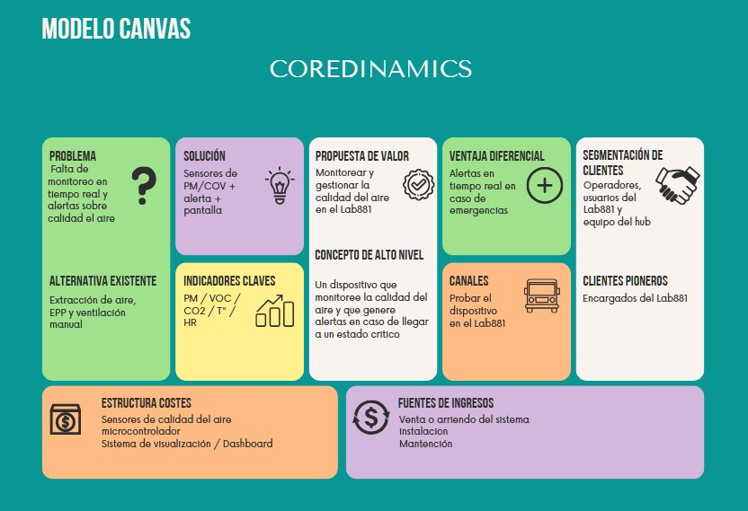

# Monitoreo y gestión de la calidad del aire en Lab881

## Capstone Intermedio 2026

**Equipo:** Dynamic Core  
**Desafío:** Monitoreo y gestión de la calidad del aire en Lab881  
**Contraparte:** Municipalidad de Providencia / Hub Providencia - Lab881  
**Estado actual:** En desarrollo

---

## Descripción

El proyecto aborda el desafío de comprender y gestionar la calidad del aire en Lab881, particularmente en el contexto de las actividades realizadas dentro del laboratorio y el uso de la máquina de corte y grabado láser.

Durante el desarrollo del proyecto, el equipo ha recopilado información mediante investigación, actividades de observación y visitas al Hub de Providencia.

A partir del levantamiento realizado en terreno, se identificaron antecedentes relacionados con los materiales utilizados, los sistemas de ventilación y extracción, los elementos de protección personal, las condiciones ambientales del espacio y las formas actuales de control de partículas.

Uno de los antecedentes relevantes obtenidos es que actualmente no existe un sistema que permita medir directamente la toxicidad del aire dentro de Lab881.

El proyecto continúa en desarrollo, avanzando desde la comprensión y definición del problema hacia el análisis de posibles soluciones y la estructuración de una propuesta conceptual.

---

## Equipo

| Integrante | Carrera o especialidad | Rol inicial | Usuario de GitHub |
|---|---|---|---|
| Vicente Urquieta Jara | Ingeniería Civil Industrial | Coordinación de información y documentación | @VicenteUrquieta |
| Fernando Leiva | Ingeniería Civil Industrial | Observación | @Hayax4 |
| Nicolás Bravo | Ingeniería Civil Industrial | Apoyo en investigación y desarrollo | @Nicolas-Bravo1 |
| Benjamin Farías | Ingeniería Civil Electrónica | Investigación, prototipo y diseño | @Benjamin-Farias |
| Victor Manquelipe | Ingeniería Civil Electrónica | Rol por definir | @usuario |

---

## Valores del equipo

- Responsabilidad.
- Comunicación.
- Colaboración.
- Respeto.
- Compromiso.

---

## Normas de funcionamiento

1. Cumplir con las tareas asignadas dentro de los plazos establecidos.
2. Mantener una comunicación activa entre todos los integrantes del equipo.
3. Distribuir las responsabilidades de manera equitativa según las capacidades y disponibilidad de cada integrante.
4. Los desacuerdos se resolverán mediante diálogo, argumentación y consenso.
5. Si no existe acuerdo, se tomará una decisión grupal considerando la alternativa más conveniente para el proyecto.
6. Las decisiones importantes, avances y modificaciones del proyecto se registrarán en GitHub y en la bitácora del equipo.
7. Mantener actualizada la documentación y evidencias generadas durante el desarrollo del proyecto.

---

## Desafío

El desafío consiste en estudiar las condiciones asociadas a la calidad del aire dentro de Lab881 y analizar cómo pueden ser monitoreadas y gestionadas considerando las actividades desarrolladas en el espacio.

El trabajo se ha enfocado principalmente en comprender el contexto, recopilar antecedentes y delimitar el problema antes de avanzar hacia una solución.

---

## Información recopilada en terreno

Durante la visita realizada al Hub de Providencia el **02-09-2026**, el equipo realizó preguntas relacionadas con los materiales utilizados, ventilación, seguridad y condiciones ambientales del laboratorio.

### Materiales utilizados

Se indicó que dentro del laboratorio se trabaja con materiales como:

- MDF.
- Acrílico.
- Cuero.
- Telas sin revestimientos químicos.
- Madera.
- Algunos polímeros.

También existen restricciones para determinados materiales debido a su comportamiento durante los procesos realizados en el laboratorio.

### Ventilación y extracción

- La máquina láser genera emisiones durante su funcionamiento.
- Existe un sistema de extracción general.
- Existe un purificador.
- Según la información recopilada, los sistemas actuales presentan limitaciones.
- Está considerada la instalación de un nuevo extractor hacia fines de año.

### Elementos de protección personal

Se utilizan elementos de protección personal como:

- Mascarillas especiales.
- Guantes de nitrilo.

Existen además especificaciones para el uso de EPP dependiendo de las actividades desarrolladas.

### Seguridad

El espacio cuenta con:

- Extintor.
- Manual de uso de los espacios.
- Elementos de protección personal.

### Condiciones ambientales

Se indicó que una temperatura cercana a **25 °C** es considerada adecuada para la zona.

Además, existe equipamiento destinado a ayudar a regular o controlar las partículas presentes en el ambiente.

### Monitoreo

Uno de los antecedentes más relevantes identificados es que actualmente **no existe un sistema que mida directamente la toxicidad del aire** dentro del laboratorio.

---

## Lo que sabemos actualmente

- El desafío está asociado al monitoreo y gestión de la calidad del aire en Lab881.
- En el laboratorio se utiliza una máquina de corte y grabado láser.
- Durante su funcionamiento se generan emisiones.
- En Lab881 se utilizan materiales como MDF, acrílico, cuero, madera, telas y algunos polímeros.
- Existe un sistema de extracción general.
- Existe un purificador.
- Los sistemas actuales presentan limitaciones según la información recopilada en terreno.
- Se utilizan elementos de protección personal.
- Existe equipamiento destinado al control de partículas.
- El espacio cuenta con medidas y elementos de seguridad.
- Actualmente no existe un sistema que mida directamente la toxicidad del aire.
- Está considerada la instalación de un nuevo extractor.

---

## Información que todavía necesitamos profundizar

- Qué contaminantes específicos se generan durante los distintos procesos.
- Qué variables son las más relevantes para evaluar la calidad del aire.
- Cuál es la efectividad real del sistema actual de extracción.
- Cuál es la efectividad del sistema de purificación.
- Qué niveles de concentración son relevantes para evaluar las condiciones del espacio.
- Qué características tendrá el nuevo extractor.
- Qué requerimientos técnicos deberá considerar una eventual propuesta.
- Qué alternativas existentes pueden utilizarse como referencia para el desarrollo del proyecto.

---

## Supuestos que requieren validación

- Que la máquina láser representa uno de los principales puntos de generación de emisiones dentro del laboratorio.
- Que el sistema de extracción actual puede presentar limitaciones bajo determinadas condiciones de uso.
- Que monitorear variables ambientales puede entregar información útil para la gestión del espacio.
- Que es posible implementar un sistema de monitoreo utilizando tecnologías disponibles y compatibles con el contexto de Lab881.

Estos elementos deberán seguir siendo contrastados con investigación, mediciones y evidencia.

---

## Definición del problema

Durante la semana del **22-09-2026**, el equipo avanzó desde la recopilación de antecedentes hacia la definición y presentación del problema.

La formulación fue desarrollada utilizando la información obtenida durante las semanas anteriores, especialmente:

- Investigación inicial.
- Visita al Hub de Providencia.
- Información entregada por la contraparte.
- Actividades de observación.
- Antecedentes técnicos recopilados por el equipo.

La definición del problema continúa siendo revisada a medida que se incorpora nueva información al proyecto.

---

## Objetivo del equipo

Desarrollar una propuesta orientada al monitoreo y gestión de la calidad del aire en Lab881, fundamentada en evidencia obtenida mediante investigación, observación, levantamiento de información en terreno y análisis de soluciones existentes, considerando las necesidades del espacio, sus usuarios y las restricciones técnicas del proyecto.

---

## Compromisos individuales

| Integrante | Compromiso |
|---|---|
| Vicente Urquieta | Cumplir con las tareas asignadas dentro de los plazos definidos y mantener actualizados los principales avances, documentos y evidencias del proyecto en GitHub. |
| Fernando Leiva | Apoyar las distintas necesidades del equipo y participar en las actividades de observación, análisis y desarrollo necesarias para cumplir los objetivos del proyecto. |
| Nicolás Bravo | Investigar y recopilar antecedentes técnicos relevantes para el desafío dentro de los plazos acordados, documentando las fuentes y hallazgos obtenidos. |
| Benjamin Farías | Apoyar la investigación, diseño y desarrollo de prototipos necesarios para avanzar hacia una propuesta técnicamente viable. |
| Victor Manquelipe | Participar activamente en las actividades del proyecto y cumplir las tareas asignadas de acuerdo con las necesidades del equipo. |

---

## Usuarios y contexto

Los principales usuarios y actores relacionados con el desafío incluyen:

- Personas que utilizan Lab881.
- Operadores de la máquina de corte y grabado láser.
- Estudiantes.
- Docentes.
- Personal encargado de la gestión y funcionamiento del laboratorio.
- Municipalidad de Providencia / Hub Providencia como contraparte.

El desafío se desarrolla dentro de **Lab881**, espacio asociado al Hub de Providencia en el que se realizan distintas actividades de fabricación y trabajo con materiales.

---

## Actividades realizadas

| Fecha | Actividad | Estado |
|---|---|---|
| 18-08-2026 | Conformación e identidad del equipo | Completado |
| 25-08-2026 | Recepción del desafío | Completado |
| 01-09-2026 | Comprensión inicial del desafío | Completado |
| 02-09-2026 | Visita y levantamiento de información en el Hub de Providencia | Completado |
| 08-09-2026 | Actividad práctica de observación | Completado |
| Semana 09-09-2026 | Investigación y organización de antecedentes | Completado |
| Semana 22-09-2026 | Definición y presentación del problema | Completado |
| 29-09-2026 | Desarrollo del Lean Canvas | Completado |
| Semana 06-10-2026 | Visita al Hub de Providencia junto a la sección | Completado |

---

## Lean Canvas

Durante la semana del **29-09-2026**, el equipo desarrolló un Lean Canvas para organizar los principales elementos del proyecto y visualizar la relación entre el problema, los usuarios y las posibles líneas de desarrollo.

El ejercicio permitió estructurar de mejor manera los antecedentes recopilados y reconocer elementos que todavía debían ser profundizados.

---

## Visitas al Hub de Providencia

### Primera visita - 02-09-2026

La primera visita permitió recopilar información directamente relacionada con:

- Materiales utilizados.
- Ventilación y extracción.
- Uso de la máquina láser.
- EPP.
- Seguridad.
- Temperatura.
- Control de partículas.
- Monitoreo de la calidad del aire.

### Visita de la sección - Semana del 06-10-2026

Durante esta semana se realizó una nueva visita al Hub de Providencia junto con la sección del curso.

La instancia permitió continuar relacionando el trabajo desarrollado durante las semanas anteriores con el contexto real en el que se desarrolla el desafío.

Las evidencias fotográficas se encuentran almacenadas en:

`imagenes/06-10/`

---

## Estado actual del proyecto

Actualmente el proyecto ha avanzado desde una etapa inicial de exploración hacia una etapa de mayor definición.

Hasta el momento se ha trabajado en:

- Comprensión del desafío.
- Levantamiento inicial de información.
- Visitas a terreno.
- Observación.
- Investigación de antecedentes.
- Identificación de información conocida y pendiente.
- Definición y presentación del problema.
- Desarrollo del Lean Canvas.
- Análisis inicial de posibles líneas de desarrollo.

El equipo continúa avanzando en la investigación y evaluación de alternativas antes de definir y desarrollar una propuesta final.

---

## Índice de la bitácora

## Bitácora del proyecto

El desarrollo del proyecto se encuentra documentado cronológicamente en las siguientes sesiones:

- [S01 - 18-08-2026 - Identidad del equipo](bitacora/S01-18-08-2026.md)
- [S02 - 25-08-2026 - Recepción del desafío](bitacora/S02-25-08-2026.md)
- [S03 - 01-09-2026 - Comprensión inicial](bitacora/S03-01-09-2026.md)
- [S04 - 08-09-2026 - Observación y levantamiento de antecedentes](bitacora/S04-08-09-2026.md)
- [S05 - 22-09-2026 - Definición y presentación del problema](bitacora/S05-22-09-2026.md)
- [S06 - 29-09-2026 - Desarrollo del Lean Canvas](bitacora/S06-29-09-2026.md)
- [S07 - 06-10-2026 - Visita al Hub de Providencia](bitacora/S07-06-10-2026.md)

> El índice deberá continuar actualizándose a medida que se incorporen las siguientes sesiones a la carpeta `bitacora/`.

---

## Evidencias principales

Hasta el momento se cuenta con:

- Ficha inicial del desafío.
- Información recopilada durante la visita al Hub de Providencia.
- Registros de preguntas realizadas en terreno.
- Fotografías de actividades de observación.
- Información sobre materiales y procesos utilizados en Lab881.
- Antecedentes sobre ventilación, extracción y seguridad.
- Presentación y definición del problema.
- Lean Canvas.
- Fotografías de la visita realizada durante la semana del 06-10-2026.
- Documentación registrada en la bitácora y repositorio del equipo.

---

## Decisiones relevantes

| Fecha | Decisión | Evidencia o criterio utilizado |
|---|---|---|
| 25-08-2026 | Comenzar por comprender el desafío antes de definir una solución. | Instrucciones iniciales del Proyecto Capstone. |
| 02-09-2026 | Complementar la información inicial mediante levantamiento directo en terreno. | Visita al Hub de Providencia. |
| Semana 09-09-2026 | Continuar recopilando antecedentes antes de cerrar la definición del problema. | Información obtenida mediante investigación y observación. |
| Semana 22-09-2026 | Avanzar hacia la formulación y presentación del problema. | Antecedentes recopilados durante las etapas anteriores. |
| 29-09-2026 | Organizar los elementos principales del proyecto mediante Lean Canvas. | Actividad desarrollada por el equipo. |
| Semana 06-10-2026 | Continuar relacionando el desarrollo conceptual con el contexto real del Hub. | Visita presencial junto a la sección. |

---

## Próximos pasos

Los próximos avances del proyecto estarán orientados a:

1. Continuar investigando soluciones existentes relacionadas con el desafío.
2. Comparar tecnologías, métodos y referentes.
3. Identificar los atributos más relevantes para una eventual solución.
4. Definir requerimientos técnicos y funcionales.
5. Evaluar la factibilidad de las alternativas propuestas.
6. Seleccionar una propuesta conceptual.
7. Avanzar posteriormente hacia el desarrollo y validación de un prototipo.

---
